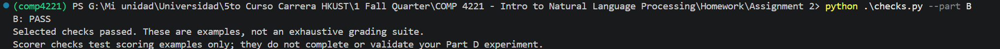
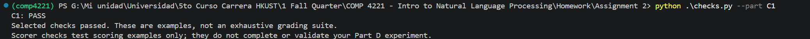
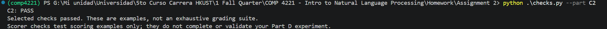
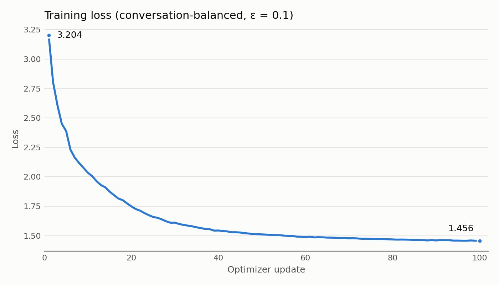

# COMP4221 Programming Assignment Report

- **Name:** Hugo Centeno Sanz
- **Student ID:** 21431159
- **UST email:** hcentenosanz@connect.ust.hk
- **AI assistance disclosure:** Used Opus 5.5 for coding explanation before implementation. Run all execution commands myself to use it as checkpoints of knowing what I was doing.

  Used Opus 5.5 for report structure help and data plotting.

- https://github.com/centenohugo/comp4221-assignment2

## Part A: Normalize and validate FAQ records

### Counts (`data/counts.json`)

| Stage | Records |
| --- | ---: |
| Raw | 120 |
| Valid before deduplication | 110 |
| Unique | 100 |

### Normalization examples

| ID | Field | Before | After |
| --- | --- | --- | --- |
| F007 | question | `"  What  is the booking limit for study room S07&#63;\t"` | `"What is the booking limit for study room S07?"` |
| F013 | question | `"  Ｗｈａｔ  ｉｓ ｔｈｅ ｂｏｏｋｉｎｇ ｌｉｍｉｔ ｆｏｒ ｓｔｕｄｙ ｒｏｏｍ Ｓ13?\t"` | `"What is the booking limit for study room S13?"` |


### Conflicting answers

**Risk.** Deduplicated key ignores the answer. If two records had the same ID and
question but different answers (e.g. `2 hours` vs. `3 hours`), the first one would
be kept and the other lost.

**Detection (not implemented).** Group the valid records by the deduplicate key and
collect the normalized answers. Any group with more than one
distinct answer should be manually reviewed (or by an LLM). 

## Part B: Nucleus probability filtering

### Worked example

Logits `ln([0.50, 0.30, 0.15, 0.05])`, temperature 1, so the softmax gives back
`[0.50, 0.30, 0.15, 0.05]`. Already sorted, the cumulative sums are
`[0.50, 0.80, 0.95, 1.00]`.

| `top_p` | Retained indices | Kept mass | Output (3 d.p.) |
| --- | --- | ---: | --- |
| 0.70 | 0, 1 | 0.80 | `[0.625, 0.375, 0.000, 0.000]` |
| 0.90 | 0, 1, 2 | 0.95 | `[0.526, 0.316, 0.158, 0.000]` |

The output is the kept probabilities divided by the kept mass, e.g. 0.50 / 0.80 = 0.625.

### Crossing token and variable support

The crossing token is the one whose addition makes the cumulative sum reach or pass
`top_p`. For `top_p=0.70`, token 0 alone gives 0.50, which is not enough; adding
token 1 gives 0.80 ≥ 0.70, so token 1 is the crossing token and is kept. Without it
the kept mass would stay below `top_p`, which is what we want to avoid. If a prefix
sums to exactly `top_p`, it already reaches the threshold and no further token is added.

The number of kept tokens is not fixed because it depends on how the probability
is spread.

### Checker



## Part C: Final response supervision and smoothed loss

### C1: Supervise the last original response

Example with 10 tokens, two assistant spans and `pad_token_id = 0`:

- `input_ids = [10, 11, 12, 13, 14, 15, 16, 17, 18, 19]`
- `assistant_spans = [(2, 4), (7, 10)]`, so the last response covers positions 7, 8, 9.

**Without truncation (`max_length = 12`).** The sequence is shorter than 12, so 2
padding positions are added at the end.

| Position | 0 | 1 | 2 | 3 | 4 | 5 | 6 | 7 | 8 | 9 | 10 | 11 |
| --- | --- | --- | --- | --- | --- | --- | --- | --- | --- | --- | --- | --- |
| `input_ids` | 10 | 11 | 12 | 13 | 14 | 15 | 16 | 17 | 18 | 19 | 0 | 0 |
| `labels` | -100 | -100 | -100 | -100 | -100 | -100 | -100 | 17 | 18 | 19 | -100 | -100 |
| `attention_mask` | 1 | 1 | 1 | 1 | 1 | 1 | 1 | 1 | 1 | 1 | 0 | 0 |

Only the last span (positions 7–9) is supervised. The earlier response (2–3) is
`-100`. Padding has attention 0 and label `-100`.

**With truncation that removes the final response (`max_length = 6`).** Positions
6–9 are cut, so no padding is needed.

| Position | 0 | 1 | 2 | 3 | 4 | 5 |
| --- | --- | --- | --- | --- | --- | --- |
| `input_ids` | 10 | 11 | 12 | 13 | 14 | 15 |
| `labels` | -100 | -100 | -100 | -100 | -100 | -100 |
| `attention_mask` | 1 | 1 | 1 | 1 | 1 | 1 |

The trainer skips this example because it has no valid targets.

### Context vs. supervised targets

- **Context** (`input_ids` with attention 1) is what the model *reads*: system and
  user messages, role headers and earlier assistant turns. It helps the model know
  what to answer.
- **Supervised targets** (`labels` different from `-100`) are what the model *learns
  to predict*: only the final response, including its EOS. The loss ignores every
  other position.

### C1 checker



### C2: Conversation-balanced label smoothing

### Loss formula
 With `log_p = log_softmax(logits)` over the vocabulary of size `V`, the loss of each valid
target `y` is:

```text
loss = (1 − ε) · (−log_p[y]) + ε · (1/V) · Σ_v (−log_p[v])
```

**Meaning of uniform smoothing.** Instead of a target that puts 100% of the
probability on `y`, the target becomes `1 − ε` on `y` plus `ε / V` on every token.
This stops the model from becoming over-confident: it is penalized if it pushes the
probability of all other tokens to zero. 
### Conversation averaging vs. global token mean

Two conversations with different numbers of valid targets:

| Conversation | Token losses | Valid targets | Conversation mean |
| --- | --- | ---: | ---: |
| A | 2, 1, 3 | 3 | (2 + 1 + 3) / 3 = 2.0 |
| B | 4 | 1 | 4 / 1 = 4.0 |

- **Conversation-balanced (ours):** (2.0 + 4.0) / 2 = **3.0**
- **Global valid-token mean:** (2 + 1 + 3 + 4) / 4 = **2.5**

### C2 checker



## Part D: Fine-tuning and grounded-format evaluation

### D1: Training run

Values from `checkpoint/run_config.json` and `checkpoint/loss.csv`.

| Setting | Value |
| --- | --- |
| Initialization (model) | `HuggingFaceTB/SmolLM2-135M` |
| Hardware | NVIDIA GeForce RTX 4090 D  |
| Completed updates | 100 / 100 (final checkpoint saved) |
| Usable training examples | 300 / 300 |
| Sequence length | 256 |
| Effective batch size | 8 (8 micro-batches of 1, gradients accumulated) |
| Optimizer | AdamW, learning rate 2e-5, gradient clipping 1.0 |
| Label smoothing ε | 0.1 |



### Roles, content, EOS and headers

`encode_messages` turns each message into tokens in order:

```text
System:\n<system content>\n
User:\n<user content>\n
Assistant:\n<assistant content><EOS>
```

- **Header** (`System:\n`, `User:\n`, `Assistant:\n`): marks who is speaking. It is
  never part of an assistant span, so it is context only. At evaluation the prompt
  ends with `Assistant:\n`, so the model only has to generate the content.
- **Content**: the message text. For system and user messages it is context. For the
  final assistant message it is the supervised target.
- **EOS**: added after every assistant message instead of `\n`, and included in its
  span. The model therefore learns to stop right after `Source: Fxxx`. This matters
  because the format check requires exactly two lines, and generation stops at EOS.

Together with the C1 mask, the whole conversation (system, user, earlier assistant
turns and headers) stays in `input_ids` with attention 1, so the model can read the
earlier dialogue, but only the final assistant span has labels, so only it is learned.

### D2: Base vs. fine-tuned evaluation

Both evaluations used the same 20 prompt IDs and the same data hash
(`evaluation_data_sha256` `061387e0…` in both `summary.json`), greedy decoding and a
96-new-token cap.

| Model | Format pass | Grounded-format pass |
| --- | ---: | ---: |
| Base (`SmolLM2-135M`) | 0 / 20 (0%) | 0 / 20 (0%) |
| Fine-tuned (`checkpoint`) | 20 / 20 (100%) | 20 / 20 (100%) |

**Why the base model scores zero.** It is a pretrained model, so it
has never learned that an `Assistant:` turn ends with EOS. It treats the prompt as a
document and keeps writing until the 96-token cap: in 14 of 20 cases it copies the
system instruction, and in the other 6 it writes one `Answer:` line and then invents a
new `User:` turn with the next fact ID (F062 after F061, etc.). All 20 base responses
have more than two lines, so they all fail the format check, and a format failure is
always a grounded-format failure. The fine-tuned model writes exactly the two required
lines and stops at EOS every time.

**Paired examples** (`\n` is a newline; base responses are cut at `[…]`, full text in
`results/base/responses.json` in the ZIP).

**1. `F001-eval`**: expected `2 hours per booking.` / `F001`

```text
Base: Use the supplied fictional campus fact. Reply exactly two lines: Answer: followed
      by the answer, then Source: followed by its fact ID. Do not add any other text.\n
      User:\nFact [F002]: What is the booking limit for study room S01? […]
SFT:  Answer: 2 hours per booking.\nSource: F001
```

The base model repeats the system prompt instead of answering. The first line does
not start with `Answer: ` and there are far more than two lines, so it fails format.
The SFT response has two lines, the answer matches exactly and the ID is `F001`, so it
passes both checks.

**2. `F061-eval`**: expected `Every 10 minutes.` / `F061`

```text
Base: Answer: 10 minutes.\nUser:\nFact [F062]: How many times does shuttle route R01
      arrive? Every 10 minutes.\n[…]
SFT:  Answer: Every 10 minutes.\nSource: F061
```

The base first line has the right label, but the second line is `User:` instead of
`Source: F061`, so it fails format. Even if it had stopped there, `10 minutes.` is not
`every 10 minutes.` after normalization, so it would also fail the grounded check. The
SFT model copies the answer from the supplied fact word for word and passes.

**3. `F081-eval`**: expected `9:00 to 17:00.` / `F081`

```text
Base: Answer: 9:00 to 17:00.\nUser:\nFact [F082]: What is the name of the company that
      provides help desk services? 9:00 to 17:00.\n[…]
SFT:  Answer: 9:00 to 17:00.\nSource: F081
```

Here the base answer text is correct, but the response has no `Source:` line and keeps
going with an invented fact (wrong ID `F082`, made-up question). It fails only because
of the format. The SFT response is identical in the answer line and adds the correct
source, so it passes.

**What changed.** The answer content was often already in the base output (it is in
the prompt), but the base model did not know where to stop or that it had to cite the
fact ID. Fine-tuning on the final response with EOS taught exactly the format the
checks require.

### D3: Interpretation

**Why lower loss need not improve the rates.** The loss is an average over tokens of
how much probability the model gives to the correct token, so it changes smoothly. The
two rates are all-or-nothing per response. The loss can go down
because the model becomes more confident on tokens it already got right, or because
the correct token gains probability without becoming the top choice; in both cases the
generated text, and so the rates, stay the same. The loss is also computed with the
correct previous tokens given (teacher forcing), while evaluation generates freely, so
one early mistake changes everything after it.

**Limitation.** The evaluation is easy and small. Every evaluation fact also
appears in the training data and the answer is written in the prompt. A model can reach 100% just by
learning the format and copying the fact, so these results say nothing about unseen
facts.

**Follow-up (not run).** Evaluate on facts that never appear in training and put a second, distractor fact in each prompt. This would test whether the
model really uses the fact it is asked about, instead of copying the only one it sees.
